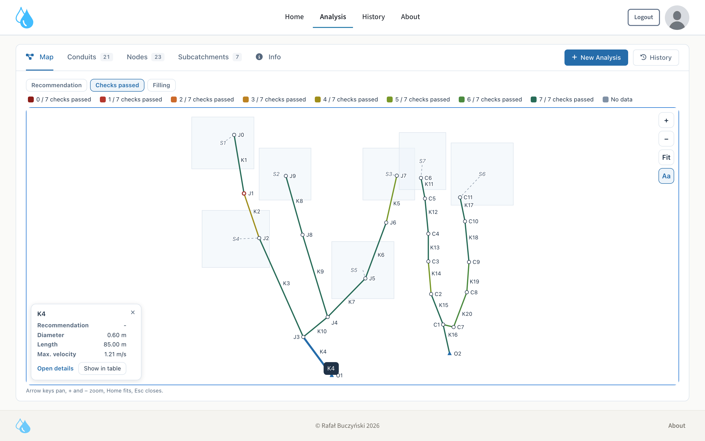
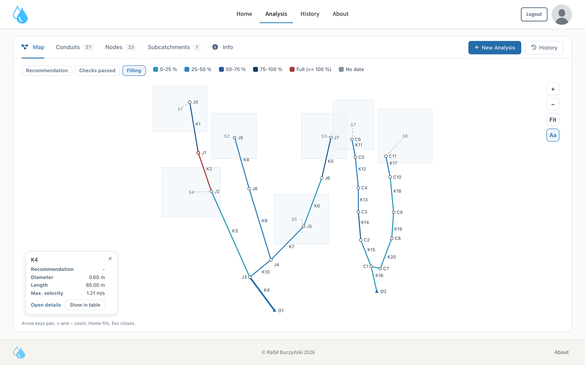

# StormLab — Stormwater Network Analysis & Validation Platform

[](https://opensource.org/licenses/Apache-2.0)

**StormLab** is an engineering and research platform for hydraulic simulation, standards-based validation, domain feature/graph construction, and interactive visual diagnostics of gravity storm sewer networks built on **EPA SWMM 5.2** and **Django 5.1**.

> **Note on Doctoral Research Artifacts:**
> This repository hosts the public source code of the StormLab web application, the pure domain layer of the `stormlab` Python library, and the hydraulic analysis engine developed as part of the doctoral dissertation by **Rafał Buczyński**. The synthetic SWMM network datasets, reproducible training pipeline, experimental benchmarks, and pretrained Graph Neural Network (GraphSAGE) / MLP model weights will be published in this repository upon completion of the formal dissertation publication process.

---

## Interactive Visualizations

### 1. Network Map — Standards Validation Mode (`Checks passed`)
Displays the full gravity sewer network topology, subcatchment polygons, runoff routing links, and per-conduit compliance against the 7 engineering validation checks (**PN-EN 752:2008** / **PN-81/B-03020**):



### 2. Network Map — Hydraulic Filling Ratio Mode (`Filling`)
Highlights peak conduit filling bands ($h/D$), surcharged conduits ($h/D \ge 100\%$), and flooded manholes:



### 3. Engineering Longitudinal Conduit Profile & Diagnostic Breakdown
Server-rendered longitudinal SVG profile (`viewBox 0 0 880 340`) showing ground surface elevation, frost protection depth, pipe crown and invert levels, water surface profile, node flooding metrics, and deterministic design rule diagnostics:


---

## Key Capabilities

- **Automated EPA SWMM 5.2 Simulation & Parsing:**
  Uploads and validates `.inp` sewer network models (requiring metric `FLOW_UNITS = CMS`), executes simulations in isolated temporary workspaces via `pyswmm`, and extracts conduit, node, and subcatchment metrics from `.inp` and `.rpt` reports.
- **Standards-Compliant Hydraulic & Geometric Validation:**
  Evaluates every conduit against **PN-EN 752:2008** and **PN-81/B-03020** engineering criteria:
  - Maximum filling ratio $h/D$ as a function of diameter (`app/sa/core/round.py::max_filling`),
  - Minimum and maximum flow velocity bounds ($0.7 \le v \le 5.0\text{ m/s}$),
  - Minimum self-cleansing slope derived from the tractive shear stress condition (`app/sa/core/round.py::min_slope`) and maximum allowable slope (`max_slope`),
  - Ground cover and frost-zone depth verification ($0.8\text{--}1.6\text{ m}$),
  - Operational band and diameter progression checks.
- **Pure Domain Library (`stormlab/`):**
  Provides a standalone, strictly layered Python package for stormwater network analysis:
  - `stormlab.contracts` — canonical feature, target, and land-cover class contracts,
  - `stormlab.hydraulics` — circular-pipe geometry (`theta`, area, wetted perimeter, hydraulic radius), Manning/Colebrook-White formulas, and validation rules,
  - `stormlab.io` — `.inp` / `.rpt` parsing and isolated SWMM simulation workspaces,
  - `stormlab.features` — conduit, node, subcatchment, and $k$-hop neighborhood feature extraction,
  - `stormlab.graph` — directed line-graph (`conduit -> conduit`) construction, topological ordering, and $k$-hop aggregation matrices.
- **Interactive SVG Network Map & Longitudinal Profiles:**
  Renders the complete sewer network topology with automatic force-directed fallback layout when node coordinates are absent (`examples/demo_network_schematic.inp`), interactive pan/zoom, hydraulic status highlighting, and per-conduit longitudinal engineering profiles.
- **Ready-to-Run Example SWMM Networks (`examples/`):**
  Includes synthetic gravity storm sewer models (`examples/demo_network_coordinates.inp` and `examples/demo_network_schematic.inp`) ready to upload directly in the web interface.

---

## Repository Structure

| Path | Description |
|---|---|
| `app/` | Django web application (`storm_analysis`, `sa`, `accounts`), templates, static assets (`app/static/`), and Docker configuration. |
| `app/sa/core/` | Application hydraulic engine (`round.py`, `valid_round.py`, `services.py`), feature engineering, network geometry extraction (`geometry.py`), and GNN/MLP model serving (`graph_constructor.py`, `predictor.py`). |
| `stormlab/` | Pure domain Python package (`contracts`, `hydraulics`, `io`, `features`, `graph`, `provenance`, `determinism`) and its 1,100+ unit & contract test suite (`stormlab/tests/`). |
| `examples/` | Ready-to-upload synthetic EPA SWMM 5.2 `.inp` demonstration networks (with georeferenced coordinates and schematic topology-only layout). |
| `docs/images/` | High-resolution screenshots of the interactive network map and longitudinal conduit profile views. |

---

## Quick Start (Local Development)

1. **Create and activate a Python 3.12 virtual environment:**
   ```bash
   python3.12 -m venv venv
   ./venv/bin/pip install -r requirements.txt -r app/requirements.txt
   ```

2. **Configure environment variables:**
   ```bash
   cp app/.env.example app/.env
   ```

3. **Apply database migrations and start the development server:**
   ```bash
   make migrate
   make run
   ```
   Open `http://127.0.0.1:8000/`, create a local account, and upload `examples/demo_network_coordinates.inp` (or `examples/demo_network_schematic.inp`).

---

## Running with Docker

```bash
cd app
docker compose up --build
```

---

## Running Tests & Static Analysis

- **Application core hydraulic & graph unit tests (`pytest`):**
  ```bash
  make test-core
  ```
- **Pure domain library (`stormlab/tests`) contract & unit tests:**
  ```bash
  make test-stormlab
  ```
- **Django web application & frontend harness tests:**
  ```bash
  make test-django
  ```
- **Linting & static type checking (`ruff` & `pyright`):**
  ```bash
  make lint
  make typecheck
  ```

---

## License & Citation

Licensed under the **Apache License, Version 2.0** — see [LICENSE](LICENSE) and [NOTICE](NOTICE) for details.
Citation metadata is provided in [CITATION.cff](CITATION.cff).
