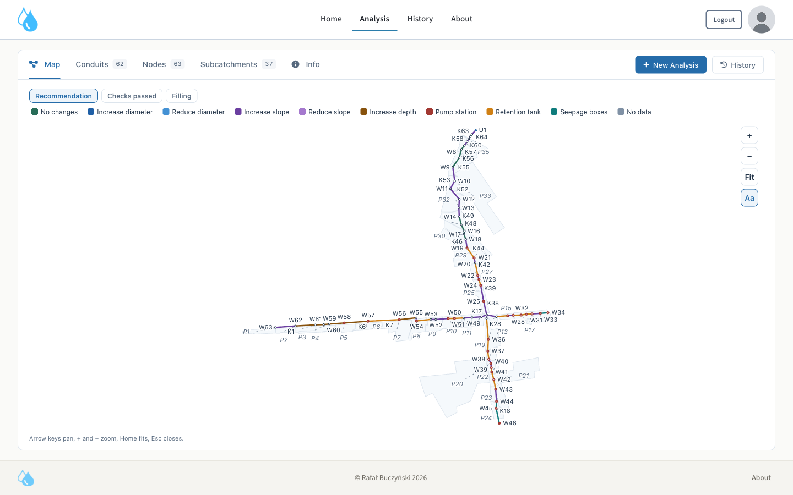
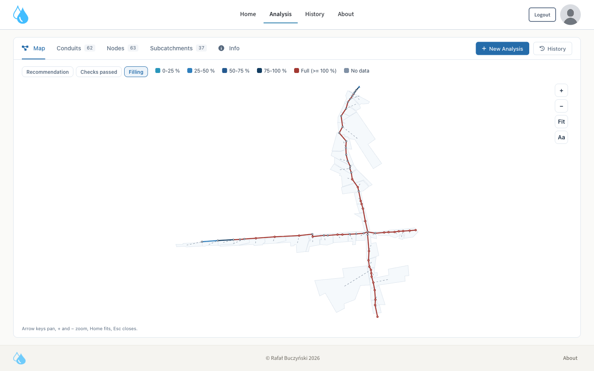
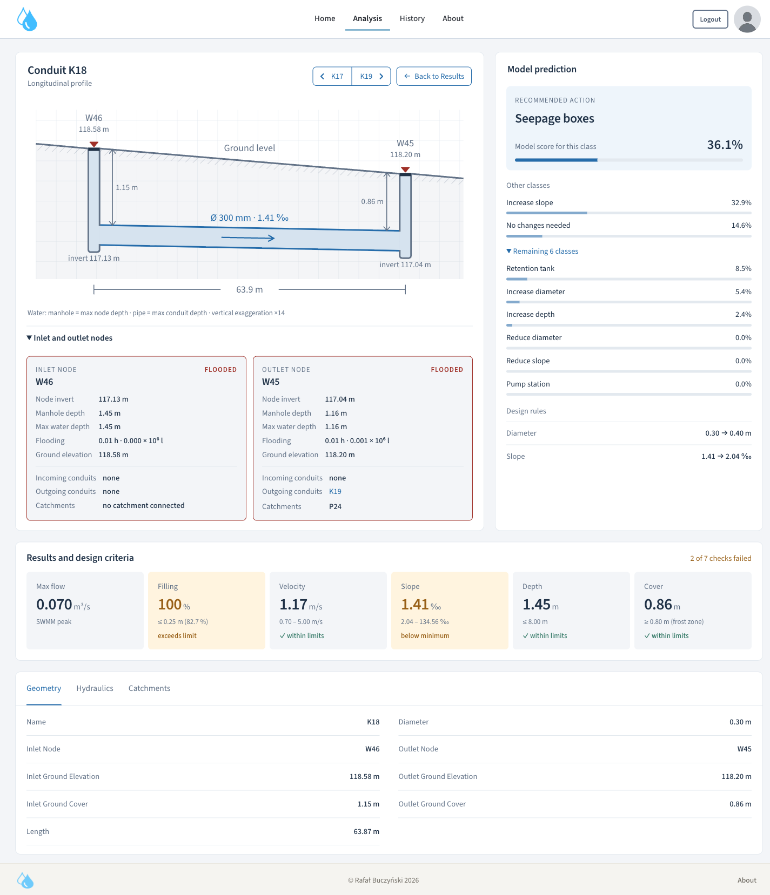

# StormLab

[](https://github.com/BuczynskiRafal/stormlab/actions/workflows/main.yaml)
[](LICENSE)

Decision support for storm sewer design. StormLab runs an EPA SWMM simulation of a
network, checks every conduit against design criteria and uses a graph neural network
to recommend an action for each conduit.



## What it does

- **Simulation.** Runs EPA SWMM 5.2 on an uploaded `.inp` model.
- **Hydraulic verification.** Seven checks per conduit: filling, velocity, slope, depth and cover.
- **Recommendations.** A graph neural network reads each conduit together with the
  conduits that drain into it and scores nine actions, from *no change* to
  *larger diameter* or *retention tank*.
- **Catchment categories.** Read from the model's tags, or assigned by a classifier.
- **Results.** Interactive network map, tables with CSV export and a longitudinal
  profile for every conduit.

The method, its evaluation and its limitations are described on the application's
**About** page.

## Quick start

Requires Python 3.12.

```bash
python3.12 -m venv venv
make install
cp app/.env.example app/.env
make migrate
make run
```

Open <http://127.0.0.1:8000>, sign up and follow the tour below.

On macOS, `make install` also re-signs the SWMM libraries: the published wheel carries
invalid code signatures and the system refuses to load it otherwise.

## Tour

1. Go to **Analysis**, pick a frost zone and choose **Try with Demo Data**. It loads the
   storm sewer network of the Rakowiec estate in Wrocław (62 conduits).
2. On the **Map** tab, switch between recommendations, passed checks and filling. Click a
   conduit, node or subcatchment for its key values.
3. Browse the conduit, node and subcatchment tables, or export them to CSV.
4. Open a conduit's details to see its profile, the seven checks and the recommended
   action with the model's score for every class.
5. Upload your own `.inp` file (flow units: CMS). More examples are in [`examples/`](examples/).

| Filling | Conduit panel |
|---|---|
|  |  |

## Models

The repository ships the trained models the application uses: the recommendation
network (five training runs, averaged) and the catchment classifier. Training code is
not part of this repository.

## Deployment

A production image and a Docker Compose setup are included; see
[docs/deployment.md](docs/deployment.md).

## Development

```bash
make test        # unit, contract and Django tests
make lint        # ruff
make typecheck   # pyright
```

Changes go through topic branches merged into `develop`; `main` holds released states.

## License and citation

Apache License 2.0, see [LICENSE](LICENSE) and [NOTICE](NOTICE).
To cite the software, use [CITATION.cff](CITATION.cff).
