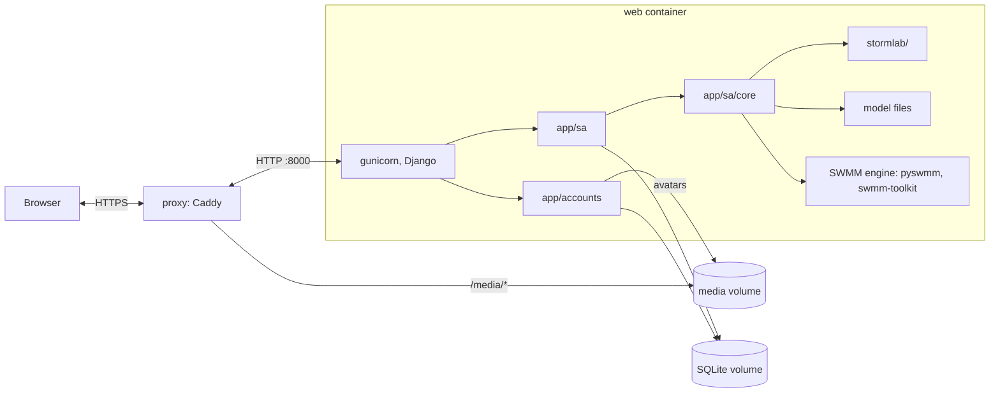
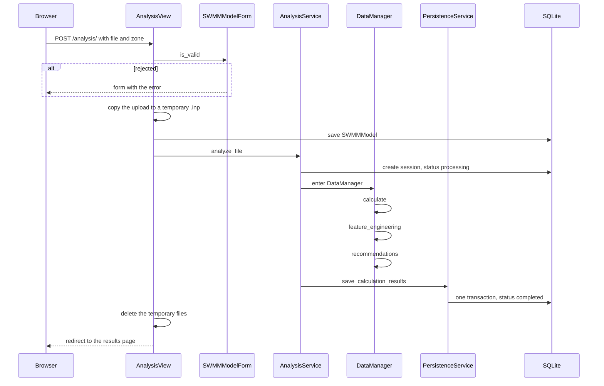
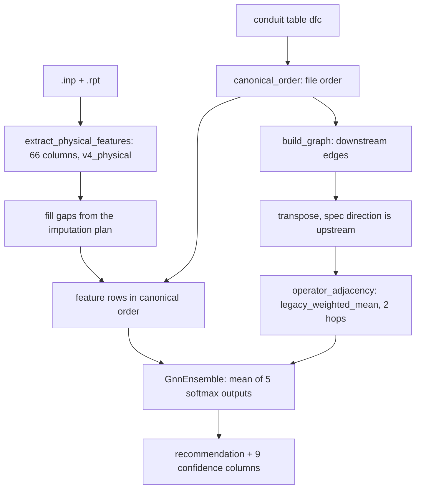
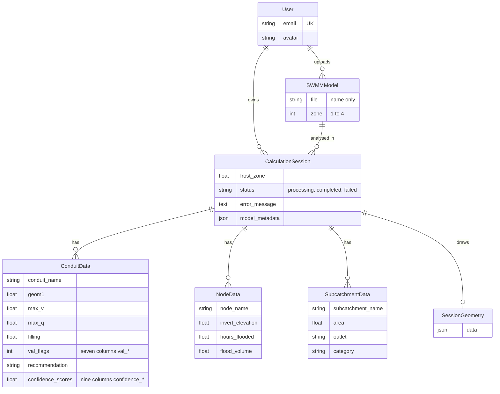

# Architecture

This document describes how the parts of StormLab fit together: the runtime components, the code layout, the path of one analysis through the application and the recommendation model. The models, how they were trained and how they were evaluated are described in [method.md](method.md); running the application in production is covered in [deployment.md](deployment.md).

## Overview

StormLab is a Django application. A signed-in user uploads an EPA SWMM `.inp` model; the application runs the simulation, checks every conduit against seven design criteria, assigns a land-cover category to every subcatchment and scores nine possible actions per conduit with a graph neural network. Results are stored in SQLite, one set of rows per analysis, and drawn in the browser. The analysis runs inside the web request, in the gunicorn worker that received it; there is no task queue and no separate worker.



- **Proxy.** `docker/Caddyfile` terminates TLS, compresses responses, limits the request body (`MAX_REQUEST_BODY`), answers 403 on `/admin/` outside `ADMIN_IPS`, serves `/media/*` from the media volume (mounted read-only) and forwards everything else to `web:8000`.
- **Web.** The `Dockerfile` builds one image with the repository layout kept (`/srv/stormlab/app`, `stormlab/`, `examples/`). gunicorn runs sync workers with one thread each, because the SWMM engine runs one simulation per process; `WEB_CONCURRENCY` sets the number of workers. Static files are collected at build time and served by WhiteNoise from the same process.
- **Start-up.** `docker/entrypoint.sh` runs `manage.py migrate` and `manage.py reap_stale_sessions --all-temp-files` before it hands over to gunicorn.
- **Models.** The recommendation network and the catchment classifier are files in the repository (`app/sa/core/recommendations/`, `app/sa/core/catchment_classifier/`). TensorFlow and the models load on first use in each worker, so the first analysis there is slower.
- **Storage.** The database is one SQLite file on the `db` volume. The `media` volume holds user avatars only (see [Data model](#data-model)).

Volumes, variables and operations are in [deployment.md](deployment.md); they are not repeated here.

## Repository layout

```text
app/                      Django project; run manage.py from here
  storm_analysis/         project package: urls, wsgi/asgi, /healthz/, base.html
    settings/             base, development, production, testing; envvars.py
  sa/                     the application: views, forms, services, models, labels, templates
    core/                 analysis code and the shipped model files
    management/commands/  reap_stale_sessions, export_method_graph
    templatetags/         versioned_static, querystring, confidence filters, sa_labels
    tests/                Django tests, .inp fixtures, Node harnesses
  accounts/               user model (e-mail login), sign-up, profile
  static/                 css/, js/, img/, data/ - served as they are, no build step
stormlab/                 domain package (see below)
  contracts/ hydraulics/ io/ features/ graph/ models/
  config.py config.yaml   closed vocabularies and design constants
  tests/                  contract/, engine/, unit/, fixtures/
examples/                 three EPA SWMM 5.2 models (see examples/README.md)
docker/                   Caddyfile, entrypoint.sh, healthcheck.py
docs/                     this file, method.md, deployment.md, images/
```

`requirements.txt` in the root adds the test and lint tools to `app/requirements.txt`, which lists what the image installs.

### Division of labour

`app/sa/core` is the analysis as the application runs it. `stormlab/` is the domain package: SWMM readers, formulas and the model definition, with no knowledge of Django.

| Concern | `app/sa/core` | `stormlab/` |
|---|---|---|
| Orchestration | `data.py`: `DataManager`, a `swmmio.Model` subclass that runs the simulation, the feature engineering and the recommendation step | none |
| Seven checks and result tables | `conduits.py`, `nodes.py`, `subcatchments.py`, `round.py`, `valid_round.py`: the feature engineering that produces the flags, limits and tables stored per session | ports of the same code (`features/conduits.py`, `hydraulics/`) |
| Model input | the legacy 33-column list (`feature_contract.py`, `constants.py`) | the `v4_physical` contract with 66 columns (`contracts/features.py`) and its extraction from `.inp` and `.rpt` (`features/physical.py`, `io/`) |
| Graph | `gnn/`: the older adjacency builder, used only for a model without a spec | `graph/`: `order.py`, `build.py`, `khop.py` |
| Model | `predictor.py` (lazy loading, switches, metadata), `graph_constructor.py` (`GnnEnsemble`, loader) | `models/`: spec reader (`gnn_spec.py`) and the network definition (`gnn.py`) |
| Other | `geometry.py` (map payload), `inp_safety.py`, `inp_options.py` (upload gates), `inp_structure.py` (bounded survey of sections and the structure check), `errors.py` (errors worded for the user) | `config.py`, `config.yaml` (design constants) |

The domain package holds ports of several application modules; their docstrings name the source. The application still runs its own copies for the checks and the tables, and imports `stormlab` for the model path only. Those imports are lazy, and `predictor.py` and `graph_constructor.py` put the repository root on `sys.path` so that `stormlab` resolves when the process starts in `app/`.

Not to be confused: `app/sa/services.py` is the Django side (persistence, serialisation for the pages, the conduit panel), while `app/sa/core/services.py` holds hydraulic formulas, the pyswmm run and the trace analysis.

### Dependency rules in `stormlab/`

`stormlab/tests/contract/test_layering.py` reads every module with `ast` (nothing is imported, so it also runs without TensorFlow) and enforces three rules:

```text
contracts  <  hydraulics  <  io  <  features  <  graph  <  models
```

1. A module imports only from its own layer or from a layer to its left. Function-local imports count, and `from stormlab import models` counts as importing `models`. Importing a `stormlab` subpackage that is not in the list is an error.
2. `config` and `tests` are cross-cutting: any layer may import them, and modules in them are not rank-checked themselves.
3. Nothing under `stormlab/` imports `app` or `sa`, and every import is absolute, because a relative import hides which layer it reaches.

The check is a single function, `check_module`, used by both the sweep over the real package and the negative tests.

## Request lifecycle of one analysis



1. `AnalysisView.post` (`app/sa/views.py`) requires a login. With `use_test_file=true` it copies `examples/wroclaw_rakowiec.inp` to a temporary file and skips the form; otherwise it builds `SWMMModelForm` from the request.
2. `SWMMModelForm.clean_file` (`app/sa/forms.py`) reads the upload as UTF-8: a file that is not valid UTF-8 is transcoded from Windows-1250, or from Latin-1 if it is not valid Windows-1250 either (`utf8_chunks` in `app/sa/core/inp_encoding.py`), so every scan below reads the bytes the engine will read. It rejects, in this order:
   - a file whose name does not end in `.inp`, in any letter case (`extension`: "Choose a SWMM input file (.inp).");
   - a file larger than `MAX_INP_BYTES` (`too_large`), before it is read;
   - a file without `FLOW_UNITS` in `[OPTIONS]` (`flow_units_missing`) or with units other than `CMS` (`flow_units`). `read_flow_units` (`app/sa/core/inp_options.py`) reads at most the first 1 MiB and 5000 lines, stops at the next section header and treats a NUL byte as no answer;
   - anything `find_unsafe_input` (`app/sa/core/inp_safety.py`) finds (`unsafe_input`): a `[FILES]` section, the `TEMPDIR` option, a rain gage, time series, temperature or evaporation entry that reads a `FILE`, an LID usage that writes a report file, and any line longer than 1023 bytes. The scan follows the engine's own reading rules (case-insensitive prefix matching of section names, `;` comments, quoted tokens, NUL ends a line). `[BACKDROP] FILE` is allowed.
   - a conduit whose cross-section is not circular (`conduit_shape`), found by `survey_inp` and `non_circular_conduits` (`app/sa/core/inp_structure.py`), which read the whole file once with the same rules. The message names the first three conduits and their shapes and says that a `CIRCULAR` cross-section is what the analysis needs. `CIRCULAR` and `FORCE_MAIN` (a circle of diameter `Geom1`) are accepted; `FILLED_CIRCULAR`, whose sediment layer changes the flow section, and every other shape are not, because the checks and the model read `Geom1` as a diameter. Cross-sections of weirs and orifices are not conduits and are ignored.
   - a model that would cost too much to run inside the request: more than `MAX_MODEL_ELEMENTS` conduits, nodes and subcatchments (`too_many_elements`, default 5000), a simulated period longer than `MAX_SIMULATION_HOURS` (`simulation_too_long`, default 168), an estimated routing work above `MAX_ROUTING_MILLIONS` million element routing steps (`too_much_routing`, default 100: elements, at least 50, × simulated time ÷ `ROUTING_STEP`; `routing_work` in `forms.py`) or an estimated binary output above `MAX_OUTPUT_MB` (`output_too_large`, default 200: elements × report steps × 24 bytes; `output_bytes`). `simulation_period` (`app/sa/core/inp_options.py`) reads every `[OPTIONS]` section with the engine's rules, checked against SWMM 5.2: the last line wins, keywords match by prefix, dates are month/day/year or month-day-year (month as a number or three letters), times and the report step are hours:minutes[:seconds] or a number of hours (`0.5` is 30 minutes), `ROUTING_STEP` is a number of seconds or hours:minutes:seconds (default 20 s), and a missing START_DATE or END_DATE means 01/01/2004. Reporting starts at REPORT_START_DATE and REPORT_START_TIME only when both are given and never before the start; the default step is 15 minutes. A value in any other form is refused by name (`option_value`) rather than guessed. Each message states the file's value and the limit. The model validator `validate_file_extension` (`app/sa/models.py`) applies the same case-insensitive extension rule.
3. `_create_temp_file` writes the upload to a temporary `.inp` in the application's own directory under the system temporary directory (`stormlab-analyses`, mode 0700; `new_analysis_file` in `app/sa/housekeeping.py`) through the same `utf8_chunks`, so swmmio, the feature extraction and the engine read one UTF-8 file, and the view saves a `SWMMModel` row with the file name only. The frost zone (1 to 4) maps to 0.8, 1.0, 1.2 or 1.4 m (`SWMMModel.ZONE_CHOICES`).
4. `AnalysisService.analyze_file` (`app/sa/services.py`) creates a `CalculationSession` with status `processing` and enters `DataManager(file_path, zone=frost_zone)` as a context manager. The constructor first runs `check_file_structure` (`app/sa/core/inp_structure.py`), which reads the file once, without swmmio, and refuses a model with no conduits, with no subcatchments (the checks and the model read catchment runoff, which such a model does not produce), or with a link whose end is a node the model does not define (named, with a hint when only the letter case differs). `__enter__` runs the whole pipeline; `__exit__` lets an exception through without logging it.
5. `DataManager.calculate` (`app/sa/core/data.py`) runs the simulation with pyswmm (`SimulationRunnerService`), which writes `.rpt` and `.out` next to the temporary file, then re-reads the model with the report, rebuilds the frames and calls `_select_recommendation_service`, which builds the graph (see below). If the engine refuses the model, `SimulationRunnerService` reads its `ERROR nnn:` lines from the `.rpt` before anything is deleted (`engine_errors`, at most five, temporary paths removed) and raises `SwmmInputError` with them. If the model cannot be read back with its report, `calculate` raises `SimulationReportError` instead of carrying on with the frames read before the run.
6. `DataManager.feature_engineering` assigns subcatchment categories, copies them to nodes and conduits, and computes the seven flags and the minimum diameter and slope figures for every conduit. The design criteria cover diameters of 0.20 to 2.00 m (`diameter_assessed` in `app/sa/core/conduits.py`); for a conduit outside that range the slope limits, the minimum diameter and the four diameter and slope suggestions are not assessed (`NaN`, stored as `NULL`), and the filling and both slope checks do not pass. The rest of the run is unaffected.
7. `DataManager.recommendations` calls `RecommendationService.recommendations`, which adds `recommendation` and nine `confidence_*` columns. Float columns are then rounded to two decimals (the confidences and the report-based node figures excepted) and unused columns are dropped.
8. `CalculationPersistenceService.save_calculation_results` first claims the session with a conditional `UPDATE` (status `processing` → `completed`, matching only a row that still exists and still runs), then writes conduit, node and subcatchment rows with `bulk_create` and the drawable geometry (`SessionGeometry`), all inside one `transaction.atomic()`. If the user deleted the session meanwhile, nothing is written and the user is told so; `save()` is never used for this, because on a deleted row it would insert the session again. Marking a failure (`mark_failed`) uses the same conditional `UPDATE`. The geometry write has its own savepoint: if it fails, the results are kept and the map is simply absent.
9. The view redirects to `sa:analysis_results`. A `finally` block then deletes the temporary `.inp` and its `.rpt`, `.out` and `.bak` (`remove_analysis_files`).

**Failure.** Any exception in step 4 to 7 marks the session `failed`, and `error_message` holds a sentence written for the user, never the exception text. An `AnalysisInputError` (`app/sa/core/errors.py`: the structure check and `SwmmInputError`) is a problem with the model and its message is stored as it is; when the GNN is enabled but cannot be used, `DataManager.recommendations` raises `RecommendationModelUnavailable` and the user sees "The recommendation model could not be used". Anything else, and any failure while saving (the transaction then leaves no partial rows), stores the fixed sentence of `unexpected_failure_message`, which gives the analysis number to report; the exception goes to the log with its traceback (`logger.exception`). The view re-renders the form with "The analysis failed: ...". A failed run keeps its `SWMMModel` and session rows, so it appears in the history. If a worker is killed mid-analysis, its session stays in `processing` and its files stay in the analysis directory. `reap_stale_work` (`app/sa/housekeeping.py`) marks sessions not updated for 30 minutes as `failed` (one `UPDATE` over the `(status, updated_at)` index) and removes analysis files of that age; the analysis form and the history page call it on every visit, so a dead worker is cleared without a restart, and no live analysis can be that old under the 180-second gunicorn timeout. `manage.py reap_stale_sessions` does the same with `--minutes` (default 30); the container runs it at every start with `--all-temp-files`, which removes every leftover file because no worker runs yet. The results page redirects to the analysis form with a message for any session that is not `completed`.

## The recommendation path in detail



The graph is built in `DataManager._select_recommendation_service` right after the simulation; the features are extracted in `RecommendationService.recommendations`. One `order` object (`stormlab/graph/order.py`) drives both, because deriving the adjacency and the feature matrix from different orders would permute the graph without any error.

**Features.** `extract_physical_features` (`stormlab/features/physical.py`) reads the `.inp` through swmmio and four summary tables of the `.rpt` (`stormlab/io/rpt.py`), never the binary `.out`, and returns one row per conduit. The application keeps the columns of `FEATURE_CONTRACT_V4_PHYSICAL` (`stormlab/contracts/features.py`): geometry, simulated maxima and hours, node freeboard, catchment aggregates, rainfall, design limits and missing-value masks. Gaps are then filled column by column from `gnn_recommender.imputation.json` (`fills`, one value per column); a column absent from `fills` gets 0.0.

Two details of this extraction differ from the rest of the analysis:

- The design constants (`frost_zone_m`, `required_cover_m`, `max_depth_m`, the filling ratio, velocity and slope constants) come from `stormlab/config.yaml` (frost zone 0.8 m as shipped), loaded without override. The frost zone chosen on the form decides the cover check (`ValCoverage`) and the panel, but is not passed to this extraction.
- Land cover is read from `[TAGS]` (`stormlab.features.subcatchments.assign_categories`); the classifier is not called here. Serving calls the extraction with `foreign_tags_untagged=True`, so a tag counts only when it names one of the 12 classes (`category_from_tag`: trimmed, compared without regard to case) and any other label is read as no tag; the extraction's default still refuses such a label. A conduit whose catchments carry no such tag has `sbc_category_code` missing, `sbc_missing` set, and the value is imputed.

**Graph.** `build_graph` (`stormlab/graph/build.py`) makes every conduit a node. `A[u, v] = 1` when the outlet node of `u` equals the inlet node of `v` after `strip().lower()`. With that orientation `A @ X` reads downstream neighbours, so the spec's `direction: upstream` transposes the matrix and each conduit aggregates the conduits that drain into it. A conduit without a name or node raises `GraphBuildError`; the legacy code dropped it silently. Substitute edges between similar conduits exist behind `surrogate_edges` and are off.

**Hop expansion.** `operator_adjacency` (`stormlab/graph/khop.py`) with `legacy_weighted_mean` and `hops: 2` computes, in `preprocess_adjacency`:

1. `A0 = A + I`;
2. `M = A0 + 0.5 · A0²`; in general the sum over k = 1..K of `0.5^(k-1) · A0^k`;
3. the diagonal of `M` is overwritten with the diagonal of `A0` (1), discarding the self terms the powers accumulated;
4. every row is divided by its sum.

The self-loops sit inside the power, so the weights are not the 1, 0.5, 0.25 that a comment in the original code suggests. On a plain chain with two hops, a conduit's row holds itself (1), its direct neighbour (2) and the one beyond (0.5), divided by 3.5. The module docstring states that the code and its tests, not the comment, are the definition. The matrix is passed to the model as a dense `float32` array.

**Model.** The weights are five bare `.weights.h5` files (`gnn_recommender.run1` to `run5`), which store numbers, not an architecture.

- `read_spec` (`stormlab/models/gnn_spec.py`) reads `gnn_recommender.spec.json` into a frozen `GnnContractSpec`. It refuses unknown or missing fields and any feature contract other than `v4_physical`. The shipped spec names operator `legacy_weighted_mean`, 2 hops, direction `upstream`, 64 hidden units, layer normalisation, `constant_safe` input normalisation, feature contract `v4_physical` and target contract `primary_action_v3`.
- `build_graph_model_for_weights` (`stormlab/models/gnn.py`) rebuilds the stack the weight file was saved from: `Normalization`, graph step, norm, dropout, graph step, norm, dropout, `Dense(9, softmax)`. Each graph step is `relu(X·W_self + (A·X)·W_neigh + b)`. The model is called once on a one-node zero input so that its weights exist, then `load_graphsage_weights` loads the file. The normaliser's mean and variance come from the file.
- `load_gnn_model_weights` (`app/sa/core/graph_constructor.py`) does this for each member and returns a `GnnEnsemble`, which requires all members to share one spec digest and one feature contract. Its `__call__` returns the mean of the members' softmax outputs. Serving calls it directly with `[features, adjacency]`, never `predict`, which would batch the list and drop the adjacency.
- `RecommendationService._assign_aligned_probabilities` (`app/sa/core/conduits.py`) aligns the probabilities to the rows of `dfc` by `Name`, takes the arg-max as `recommendation` and stores the nine scores, rounded to three decimals, as `confidence_pump`, `confidence_tank`, `confidence_seepage_boxes`, `confidence_diameter_increase`, `confidence_diameter_reduction`, `confidence_slope_increase`, `confidence_slope_reduction`, `confidence_depth_increase` and `confidence_valid`. The class order is `RecommendationCategory` (`stormlab/contracts/enums.py`), which is the softmax layout.

**Switches.** `app/sa/core/predictor.py` reads these environment variables; they are not listed in `app/.env.example`.

| Variable | Default | Effect |
|---|---|---|
| `GNN_ENABLED` | unset | `1`, `true`, `yes` or `on` (any case) enable the GNN and any other value disables it. Unset means enabled when at least one configured weight file exists. Read on every call. |
| `GNN_WEIGHTS` | `gnn_recommender.run1.weights.h5` to `run5` | Comma-separated file names inside `app/sa/core/recommendations/`. Blank means the default. |
| `GNN_SPEC` | `gnn_recommender.spec.json` | Spec file in the same directory. |
| `GNN_IMPUTATION` | `gnn_recommender.imputation.json` | Imputation plan in the same directory. |
| `GNN_MODEL_ID` | `gnn_recommender_v1` | Identifier recorded in the model metadata; it does not affect loading. |

All but `GNN_ENABLED` are read once, when `predictor.py` is imported. `GNN_MAX_HOPS` (default 2) exists too; only the older adjacency path under `app/sa/core/gnn/` reads it.

**Never a partial ensemble.** `load_gnn_model_weights` first checks that every member file, the spec and the imputation plan exist, and otherwise refuses with a `GNNModelLoadError` that lists what is missing; the error is logged and the loader returns `None`. A missing member therefore means no GNN, not a smaller ensemble. `DataManager` then falls back to the optional MLP service, whose model file (`recommendations_classifier_path` in `predictor.py`) the repository does not ship. With the GNN enabled and no model, the analysis fails with `RecommendationModelUnavailable` and stores nothing. With `GNN_ENABLED=false` it completes with `recommendation` set to `-` and all confidences 0.0. The Django system check `sa.E001` (`app/sa/checks.py`) also reports missing model files when the project starts, unless `GNN_ENABLED` switches the GNN off.

**Metadata.** `get_model_metadata()` returns `model_kind` (`gnn`, `mlp` or `none`), `model_id`, `weights_sha256` (sha256 over the concatenated hex digests of the five files in run order, `None` if one is missing), `feature_contract`, `target_contract` (both read from the spec), `gnn_enabled` and `ensemble_members` (the number of weight files averaged: five for the shipped GNN, one for the MLP). It is stored on the session (`CalculationSession.model_metadata`) in the same `UPDATE` that completes it. The results page (Info tab) and the conduit panel show the stored value through `session_model_metadata` (`app/sa/services.py`), with the same keys plus `recorded`; a session completed before the field existed has `recorded` false and every other key `None`, rather than naming the model installed today.

**Catchment classifier.** `SubcatchmentFeatureEngineeringService.subcatchments_classify` (`app/sa/core/subcatchments.py`) assigns one of 12 categories to every subcatchment. Tags take precedence:

- A `Subcatch` row of `[TAGS]` whose tag names one of the 12 categories, trimmed and compared without regard to case, gives the subcatchment that category in its canonical spelling (`stormlab.features.subcatchments.category_from_tag`). Any other label, such as a district name, counts as no tag; tags of nodes and links are ignored. When every subcatchment is tagged, the classifier is not called.
- Subcatchments without such a tag, or all of them when the file has no `[TAGS]` section, go to the classifier (`app/sa/core/catchment_classifier/model.keras`). Its 12 inputs are `PercImperv`, `PercSlope`, `N-Imperv`, `N-Perv`, `S-Imperv`, `S-Perv`, `PctZero`, `RunoffCoeff` and `TotalInfil`, `ImpervRunoff`, `TotalRunoffMG`, `PeakRunoff`, the last four divided by `Area`. Missing values become 0. The 12 output units follow the alphabetical order of `SUBCATCHMENT_CATEGORIES` (`app/sa/core/constants.py`).
- If the classifier is unavailable or a column is missing, the category stays unset and is stored as `-`.

`stormlab/contracts/catchment_features.py` records the same 12 inputs and the class order (`CLASSIFIER_CLASS_ORDER`) and guards the division by `Area`. That order is not the one-hot order of the conduit contract (`FEATURE_ONEHOT_ORDER`); the two are kept apart on purpose.

## Data model



The user model is `accounts.User` (`app/accounts/models.py`), which signs in with the e-mail address. Every relation cascades on delete. Deleting sessions from History (`SessionDeletionService`) also deletes each `SWMMModel` left without a session; migration 0012 removed the ones left behind earlier. `ConduitData`, `NodeData` and `SubcatchmentData` are unique per session and name. `ConduitData` and `NodeData` also carry the subcatchment and category (`subcatchment`, `sbc_category`) assigned to the element.

**Stored:** per session, the hydraulic results and the seven flags of every conduit, the diameter and slope figures, the recommendation and its nine scores; the node and subcatchment tables; the frost zone; and the drawable geometry as JSON (`SessionGeometry.data`, produced by `extract_geometry` in `app/sa/core/geometry.py` from the `.inp` sections alone, with an automatic schematic layout when the file has no coordinates).

**Not stored:** the uploaded file. `SWMMModel.file` is a `FileField`, but the view assigns the file name to it and saves, so nothing is written under `MEDIA_ROOT`; the temporary copy, the `.rpt` and the `.out` are deleted when the request ends. The `media` volume therefore holds avatars only.

## Front end

The pages are server-rendered Django templates: `app/sa/templates/sa/` holds one template per page (`analysis.html`, `analysis_results.html`, `conduit_panel.html`, `history.html` and the public pages `index.html`, `about.html` and `method.html`) and a few partials; `app/accounts/templates/` holds the login, sign-up and account pages and a logout page for a typed or bookmarked `/accounts/logout/` (Django's logout view accepts only POST). All extend `app/storm_analysis/templates/base.html`: the StormLab wordmark, a "Skip to content" link that moves focus to `<main>`, the header and footer, and the title, which base.html writes as "<page> · StormLab" (the home page alone overrides it). Under the header base.html renders the queued `django.contrib.messages` as one strip, styled per level (success, info, warning, error); errors and warnings are announced with `role="alert"`, the rest with `role="status"`, and each can be dismissed. Next to it live the error pages: `400.html`, `403.html` and `404.html` extend `base.html` and include the shared card `errors/_card.html`; `500.html` is self-contained, because Django renders it without a request or context processors. No page carries an inline `<style>` block (a smoke test checks it). There is no build step and no package manager for the browser code; `app/static/js/` holds plain scripts and `app/static/css/` plain stylesheets.

**One vocabulary.** `app/sa/labels.py` is the one place for what a person reads instead of an internal code: `ACTION_LABELS` ("No changes", "Increase diameter", ... "Seepage boxes", in the order the filters list them), `CATEGORY_LABELS` ("Urban, highly impervious") and `ACTION_MEANINGS` for the About page; an unknown code is spelled out as words. The database, the model and the machine columns of the CSV exports keep the codes. Templates reach the labels through the filters of `app/sa/templatetags/sa_labels.py`, which also hold the one format of a date, `utc_datetime` ("5 Mar 2026, 04:43 UTC", no leading zero; its `"date"` and `"time"` parts serve History and the account page), and of a frost zone, `zone_label` ("Zone I (0.8 m)", from `zone_label()` in `app/sa/models.py`, which the analysis form's choices use as well), plus `file_label` for the bare name of an uploaded file. `AboutView` passes the actions and the categories to the About page, which shows each category with the id a `[TAGS]` entry uses.

| Page | Script | Role |
|---|---|---|
| every page | `main.js` | Bootstrap tooltips where a template asks for one, back-to-top button (lifted above the footer, shown only while scrolling up on phones); the file drop zones (analysis form, avatar); on the analysis form the inline errors for an empty submit and for a file whose name does not end in `.inp` (the server's message, before any upload), the progress state and the double-submit guard; on the account page focus on the first rejected field; on the history page the filter form, the error disclosure and single and bulk delete (`fetch` to `/session/<id>/delete/` and `/sessions/bulk-delete/` with the CSRF token, then the last page that still exists) |
| results | `results-v2.js` | tabs (Map, Conduits, Nodes, Subcatchments, Info) with a roving tab index, the chosen tab remembered per session in `sessionStorage` (`stormlab-results-tab-<id>`) and kept in the URL fragment, which also opens a tab directly; on a narrow screen the tab row scrolls sideways and fades at the edge that hides more tabs; search, filters, sorting, column chooser, inline check details, CSV export of the visible rows |
| results | `network-map.js` | the network drawn as SVG in the browser: subcatchment outlines, outlet lines, links, nodes, names; three colourings with a legend of every entry and a key for a flooded node; the selection card |
| conduit panel | `conduit-panel.js` | longitudinal profile (SVG, or a message when the conduit cannot be drawn) and the detail tabs; Back to Results gets the tab the results page remembered for the session as its URL fragment |
| About, Method | `docs.js` | table of contents: anchor offset below the header and the active entry while scrolling (a clicked entry stays active; near the end of the page the activation line moves down); the edge fade and the scroll hint of the wide figures |
| Method | `method-graph.js` | the figure that shows, on the Rakowiec network, which conduits the model reads for a selected conduit |

**Layout.** From 576 px wide the results page fits the viewport and the table scrolls inside it (`app.css`); below that the page scrolls and the table frame and the map get heights of their own (`results-v2.css`, whose rules are all scoped under `#storm-results-v2`). The conduit panel has its own skin, the `conduit-panel` block of `app.css`.

**How data reaches the scripts.** `AnalysisResultsView` (`app/sa/views.py`) loads the session with its conduits, nodes and subcatchments and passes two payloads that `analysis_results.html` embeds with `json_script`:

- `results-v2-data`, from `CalculationRetrievalService.serialize_session_for_results_v2` (`app/sa/services.py`): conduits, nodes and catchments with their derived fields, summary counts, `labels` (`actions` and `categories`, the maps of `sa/labels.py`, so the browser holds no second copy) and session metadata. Every conduit row carries `action_label` and `category_label` beside the codes, and `limits_assessed` (false for a diameter outside 0.2–2.0 m, whose limits the tables show as "n/a"); node and catchment rows carry `category_label`. `recommendation_label` keeps its stored wording ("No changes needed"), which the exports use. The session metadata are the id, the frost zone, `model_metadata` as stored with the session (`session_model_metadata`, with `recorded`) and `model`, the same model in words for the Info tab (`describe_model`: "Graph model, five runs averaged" with the count stored in `ensemble_members`, "Graph model" for a session stored without that key, or "not recorded" for a session completed before the metadata were stored). Non-finite numbers become `null`, because JSON has no literal for them. Only the confidence of the recommended class and its margin to the runner-up are included; the nine scores are read by the conduit panel from `ConduitData`.
- `network-map-data`, from `serialize_geometry_for_map`: an envelope `{available, reason, data}`. `reason` is `no_geometry` or `too_large`; above 6000 elements or 120000 coordinate pairs (`NETMAP_MAX_ELEMENTS`, `NETMAP_MAX_POINTS`) the payload stays in the database and the page says so.

`results-v2.js` and `network-map.js` share only the visibility of `#r-map-panel`. The conduit panel embeds `panel.diagram_data` as `conduit-data`, built by `ConduitPanelService.build` in at most four queries; it names the model from the session's stored metadata, like the Info tab. Both `network-map.js` and `conduit-panel.js` export their pure functions through `module.exports` when there is no `document`, so Node can test them.

**CSV exports.** The CSV button of the results page writes the rows currently shown, with the columns' original headers (a column renamed on screen carries its old header explicitly) and the raw category codes. The route `export_session_csv` (`/analysis/results/<id>/export/<kind>/`, kinds `conduits`, `nodes`, `catchments`) returns the full, unpaginated table with spreadsheet formula characters neutralised; its columns are the keys of the payload rows, and keys added since (`limits_assessed`, `action_label`, `category_label`) come after the existing ones, so every earlier column keeps its position (a test freezes them). The templates and scripts do not link to it.

**External assets.** `base.html` loads Bootstrap 5.1.3 (CSS and JS bundle, jsDelivr) and Font Awesome 6.4.0 (cdnjs), both with `integrity` and `crossorigin`, and Google Fonts without an integrity attribute. The map and the profile need no third-party library.

**Cache busting.** `` (`app/sa/templatetags/sa_static.py`) appends `?v=<mtime>` of the source file found by the staticfiles finders, so a changed stylesheet or script gets a new URL; it returns the bare URL if the file is not found. `base.html` (`app.css`, `main.js`) and the results, conduit panel, About and Method templates use it.

**The figure on the Method page.** `method-graph.js` fetches `app/static/data/method-graph.json`: the geometry of the Rakowiec network and, for every conduit, the rows of the aggregation matrix after one and two graph steps. The file is written by `manage.py export_method_graph` (`app/sa/management/commands/export_method_graph.py`), which reads operator, hops and direction from `gnn_recommender.spec.json` and builds the matrix with `canonical_order`, `build_graph` and `operator_adjacency`, as `_select_recommendation_service` does. `export_method_graph --check` fails when the file no longer matches a fresh build; run the command after a change to the demo network, the graph code or the model spec.

## Guarantees and tests

**Contract tests** (`stormlab/tests/contract`) pin what a model depends on. `test_features.py` fixes the order, dtypes and digests of the feature contracts (33 columns for `v1`, 66 for `v4_physical`) and that a frame is rejected rather than repaired. `test_catchment_features.py` covers the 12-feature catchment contract and the divide-by-`Area` guard. `test_enums.py` keeps the class vocabularies and their orders from drifting. `test_layering.py` enforces the dependency rules above. The unit tests (`stormlab/tests/unit`) cover the readers, the hydraulics ports, graph construction, ordering, the hop scheme on an 11-conduit chain and the configuration; `stormlab/tests/engine` runs SWMM to check the sentences it prints for empty report tables. Tests marked `parity` are opt-in (`pytest --run-parity`), and tests marked `slow` run a full simulation.

**Golden and parity tests for the shipped models** (`app/sa/core/tests`, fixtures in `fixtures/*.npz`):

- `test_gnn_shipped_model.py`: the model loads with spec `legacy_weighted_mean`, 2 hops, `upstream`; contract `v4_physical` with 66 columns; an imputation plan with 66 fills; recommendations on the Rakowiec network; metadata follows `GNN_ENABLED`.
- `test_gnn_model_parity.py` with `gnn_demo_parity.npz` and `gnn_rakowiec_golden.npz`: each of the five runs reproduces its reference probabilities (absolute tolerance 1e-5), the served model equals their mean, a missing run makes the loader return `None`, all model files exist, and the metadata digest covers all five. The `slow` tests run SWMM and the whole pipeline and compare recommended classes only, because a simulation is not bit-reproducible across platforms.
- `test_gnn_serving.py`: serving without an adjacency raises before the model is called; the model is called directly, not through `predict`; a stray `.keras` file cannot bypass `GNN_CONFIG`; the default paths derive from the configuration.
- `test_gnn_killswitch.py`: model selection falls back to the MLP service when the GNN is disabled, unavailable or its graph cannot be built, and never serves a GNN without a graph.
- `test_catchment_classifier_model.py` with `catchment_classifier_rakowiec.npz`: the classifier file exists, reproduces its reference probabilities, and an untagged copy of the Rakowiec network gets its categories from it.
- `test_feature_contract.py` keeps a golden copy of the legacy 33 columns.

**Upload safety** (`app/sa/tests/test_forms.py`, `test_inp_options.py`, fixtures in `app/sa/tests/data/`): the size limit, the CMS gate, binary and single-line hostile content, each way a file can name another file, the line limit, a section header hidden behind a NUL byte, look-alikes that must pass, CRLF files, that every shipped and test model passes, and an end-to-end upload with a `[FILES]` section that must write nothing and create no session.

**Django tests** (`app/sa/tests`, `app/accounts`) cover the views (analysis, results, conduit panel, history), the serialisation and the CSV endpoint with its frozen columns (`test_results_v2.py`), the four-query budget of the panel, geometry extraction, failed analyses (`test_analysis_model_unavailable.py`), `reap_stale_sessions`, the model-file system check, the labels and the template tags, and smoke tests of the pages: titles, messages, error pages, no inline styles, one date and zone format. `test_method_graph.py` rebuilds the data of the Method page's figure and compares it with the committed file, so the figure cannot drift from the graph code.

**Node harnesses** (`app/sa/tests/harness_results_v2.js`, `harness_network_map.js`, `harness_conduit_profile.js`) check the results page against a simulated DOM, the pure layer of the map, and the markup of the profile. The Django tests run them through `node` and skip them when it is missing; each also runs on its own, for example `node app/sa/tests/harness_network_map.js`.

**Deployment checks.** `app/sa/tests/test_deployment.py` covers the environment parsing helpers, the `SECRET_KEY` rules and `/healthz/`. The `deploy-check` job in `.github/workflows/main.yaml` runs `manage.py check --deploy --fail-level WARNING` and `collectstatic`, builds the image, starts it read-only and waits until it is healthy, then validates the Compose file and the Caddyfile. The other two jobs run the pre-commit hooks (ruff, pyright and file checks) and the test suites: `pytest app/sa/core/tests stormlab/tests`, then the Django tests with `DJANGO_ENV=testing`.

**Make targets.** `install`, `migrate`, `run`; `test` (which runs `test-core`, `test-stormlab` and `test-django`); `lint` (ruff), `typecheck` (pyright); `check-deploy`, `collectstatic`; `docker-build`, `docker-up`.

## Configuration

Django settings live in `app/storm_analysis/settings/`. `DJANGO_ENV` selects the module: `development` (the default), `production` or `testing`; any other value raises `ImproperlyConfigured`. `base.py` holds what the three share, including the SQLite path, the media and static locations, `MAX_INP_BYTES`, the cost limits `MAX_MODEL_ELEMENTS`, `MAX_SIMULATION_HOURS`, `MAX_OUTPUT_MB` and `MAX_ROUTING_MILLIONS`, and `REGISTRATION_OPEN`, and loads `app/.env` with python-dotenv. `production.py` adds the secret key and host checks, the HTTPS redirect behind the proxy header, HSTS, SQLite write-ahead logging and WhiteNoise; `testing.py` uses an in-memory database. `envvars.py` parses and validates the variables (`env_bool`, `env_int`, `env_path`, `env_list`, `required_list`, `secret_key`), treating a blank value as unset. `app/.env.example` lists every application variable with its default.

The model switches in [The recommendation path in detail](#the-recommendation-path-in-detail) are read from the environment by `predictor.py`, and the design constants of the physical features from `stormlab/config.yaml`, which `stormlab/config.py` validates when it loads.

For production variables, volumes, health checks and backups, see [deployment.md](deployment.md).
