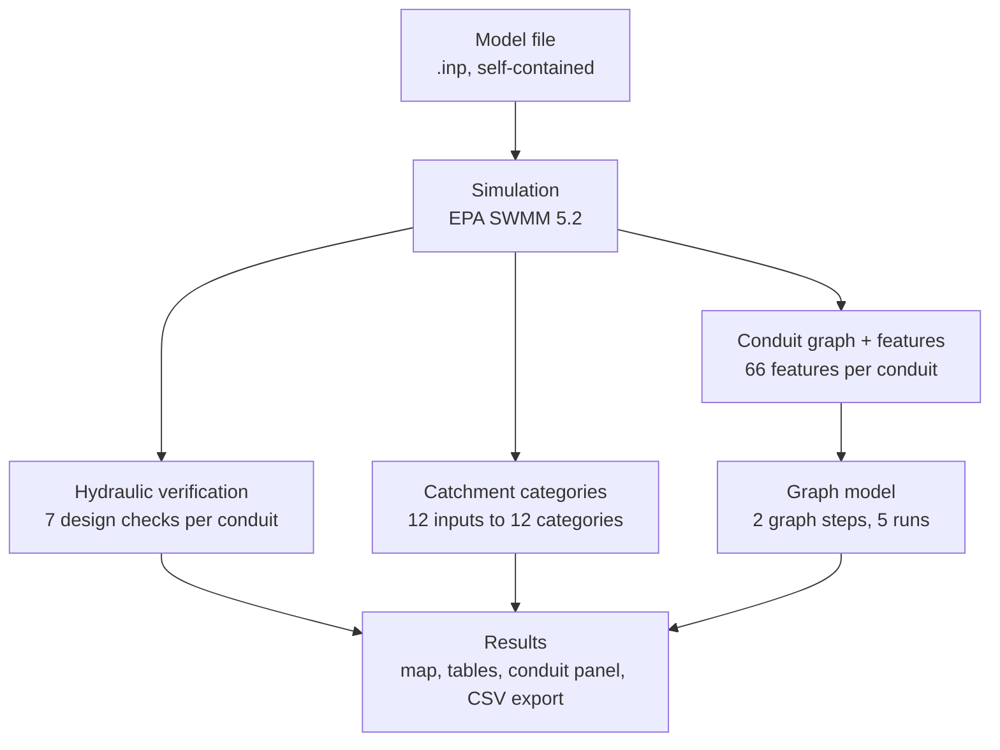
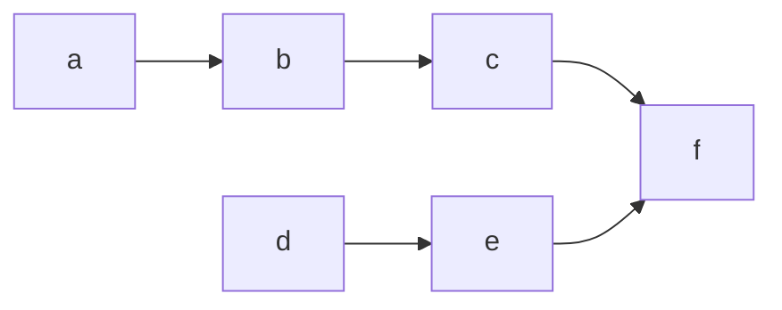
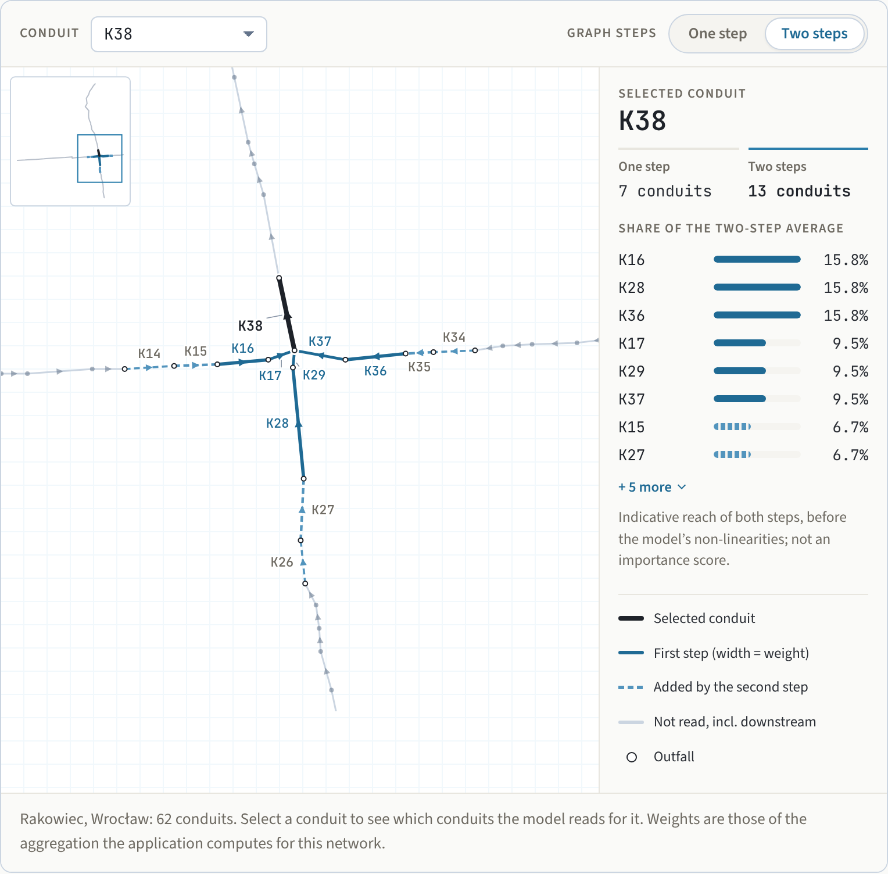
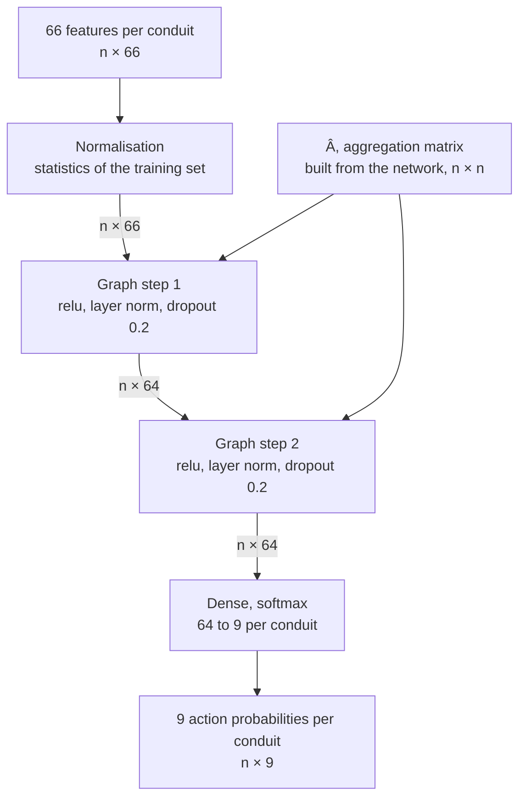

# Method

The method behind the application: how a sewer network becomes a graph, what the model reads from it, how it was trained and tested, and why the approach holds up.

The same content, with an interactive view of what the model reads on the demo network, is served by the application at `/method/`. The structure of the code is described in [architecture.md](architecture.md).

## The problem

A hydrodynamic simulation tells a designer what happens in a storm sewer network: where conduits run full, where manholes flood, where the flow is too slow to keep a pipe clean. Design criteria turn those results into verdicts, conduit by conduit. Neither says what to do about it.

The answer rarely lies in the failing conduit alone. A pipe that overflows may be too small, or may be paying for an oversized catchment that a retention tank upstream would tame. A diameter can be reduced only if nothing wider drains into it. A conduit with too little cover and too little slope calls for one decision, not two. Choosing an action means reading the conduit together with what flows into it.

StormLab learns that reading from assessed networks. For every conduit it returns a probability for each of nine actions: no change, a larger or smaller diameter, a steeper or gentler slope, a deeper invert, a retention tank, infiltration, or a pumping station. It narrows down where to look and what kind of intervention to consider. Sizing the intervention and checking it by a new simulation remain the designer's work.

## One analysis, end to end

An analysis starts from a SWMM input file and ends with stored results. The simulation is the only source of hydraulics: the models never estimate a flow or a water level, they interpret the ones the engine computed.



*Figure 1. One analysis, from upload to results. The simulation supplies the physics; the models only read its outcome.*

1. **Upload.** The file is scanned before the engine sees it. A model must be self-contained: constructs that would make SWMM read or write other files are rejected.
2. **Simulation.** EPA SWMM 5.2 runs on a temporary copy, with the routing method, time steps and rainfall declared in the file.
3. **Verification.** Each conduit is checked against seven design criteria. The verdicts are shown to the user; the recommendation model does not read them.
4. **Catchment categories.** Land-cover categories come from the model's tags; subcatchments without a tag are classified from their parameters and runoff.
5. **Recommendation.** The network is rebuilt as a graph of conduits, each described by 66 physical quantities, and the graph model scores the nine actions.
6. **Results.** Everything is saved per analysis and shown on the map, in the tables and in the panel of each conduit.

## A network as a graph of conduits

A sewer network is usually drawn as manholes joined by pipes. The decisions, however, concern the pipes. StormLab therefore turns the drawing inside out: every conduit becomes a node of the graph, and two conduits are linked when the first ends in the manhole where the second begins. Edges point with the flow, towards the outfall.

In the example below, each node is a conduit; conduits a, b and c form one branch, d and e a second, and both meet before conduit f.



*Figure 2. Conduits become nodes; an edge joins two conduits that meet in a manhole and points with the flow. For conduit f, one graph step averages over f itself, c and e, and with a smaller weight b and d.*

On this graph the model takes two *graph steps*. In each step a conduit combines its own description with a weighted average over the conduits that drain into it: itself, the conduits one link upstream and, with a smaller weight, those two links upstream. Before normalisation the weights stand in the ratio 1 : 2 : 0.5; each row then sums to one. Two steps chained reach four links upstream.

Information travels with the water and never against it. What happens downstream still reaches the model, but through the simulation: backwater shows up in the water levels and surcharge times of the conduit itself.

### What the model reads for one conduit

The figure below uses the network of the Rakowiec estate, the one loaded by **Try with Demo Data**. The weights are not an illustration: they are the aggregation the application computes for this network, exported by the same code that serves the model.



*Rakowiec, Wrocław: 62 conduits. For the selected conduit, K38, the figure marks the conduits the model reads in two graph steps and their shares. Weights are those of the aggregation the application computes for this network; in the application the conduit can be chosen.*

Conduits at the head of a branch have nothing upstream and are assessed on their own description alone. In the test data they carry about a fifth of the weight, which bounds what any use of context can add.

### What the model knows about a conduit

Each conduit is described by 66 numbers taken from the input file and the simulation report. They are physical quantities in their own units, not scores and not verdicts: the model sees that the water stood 0.4 m above the ground, not that a check failed.

| Group | Features | Content |
|---|---:|---|
| Geometry | 17 | Diameter, length, roughness, barrels, offsets, inverts and slope; ground level, invert depth, cover and manhole depth at both ends |
| Hydraulic state | 19 | Peak flow and velocity, filling and flow relative to full-pipe capacity, hours of surcharge, peak water levels and flooding of the manholes at both ends |
| Freeboard | 2 | Ground level minus peak water level at each end; negative when water reached the surface |
| Catchment and rainfall | 8 | Land-cover category at the inlet; area, imperviousness, width and slope of everything upstream; depth, duration and peak intensity of the rainfall |
| Design requirements | 8 | Required cover, frost depth, depth and filling limits, velocity limits, and the slope limits that follow for this conduit |
| Receiving water | 1 | Fixed water level at the outfall, where one is declared |
| Indicators | 11 | Facts about the network and the file: an outfall conduit, a non-positive slope, a value the file does not provide |

A quantity the file does not provide is replaced by its mean in the training data, and the matching indicator tells the model that it was.

## The model

The network is small by design. The input is normalised with statistics of the training data; two graph steps of 64 units follow, each with layer normalisation and dropout; a final layer turns the result into nine probabilities per conduit.



```text
h = relu(X·W_self + (·X)·W_neigh + b)
```

*Figure 3. Two graph steps with shared weights for every conduit, which is why one set of weights serves a network of any size. The model is trained in five training runs, mean of the probabilities; 17,742 parameters per run.*

In one graph step the model adds two terms: the conduit's own features passed through one weight matrix, and the weighted average over its inflow neighbourhood passed through another. Keeping the two apart lets the model compare a conduit with what feeds it, for instance its diameter with the diameters upstream.

The same weights are applied to every conduit of every network. Nothing in the model depends on the number of conduits or on the layout, so a model trained on networks of some twenty conduits can assess a network of sixty or six hundred.

- **Parameters per run:** 17,742
- **Hidden units:** 64
- **Dropout:** 0.2
- **Runs averaged:** 5

The application serves five training runs of this model that differ only in their random seed, and averages their probabilities. The score shown in a conduit's panel is that average. The five files are described by one specification; if any of them is missing the application refuses to serve a partial ensemble.

## Data

The recommendation model was trained and tested on 5,056 SWMM models of gravity storm sewer networks with 107,248 conduits, about 21 per network. The models belong to 266 network families. A family is one network layout with all its design variants and rainfall scenarios: 216 families of varied layout, from single chains to branched and irregular trees, and 50 families of flat, densely built-up terrain with small diameters.

- **Diameters:** 0.2 to 2.0 m
- **Slopes:** 0.2 to 150 ‰
- **Roughness:** n = 0.010, 0.013, 0.016
- **Design rainfall:** four events: 60 min, 23.2 mm; 120 min, 26.8 mm; 120 min, 33.4 mm; 135 min, 52.3 mm
- **Routing:** dynamic wave, 5 s step

The set is deliberately rich in trouble. Depending on the group of networks, 15 to 27% of conduits have a flooded inlet manhole and 55 to 74% run under pressure at some point of the event.

### What a label is

Every conduit carries an assessment: how strongly each of the nine actions is supported for it, as shares that sum to one. The action with the highest support is the *main action*. Every action with a support of at least 0.2 is *admissible*. In 8.4% of conduits two actions share the top support; these conduits take part in training and are judged on admissibility, not on a single right answer. A small share of conduits (0.3%) has no assessment: they stay in the graph as neighbours and are left out of the loss.

### Dividing the data

Networks of one family resemble each other, so a family goes into exactly one part. When the data were divided by file instead, 4.1% of test conduits had a near-duplicate in the training part; divided by family, none has.

| Part | Families | Conduits |
|---|---:|---:|
| Training | 162 | 63,824 |
| Validation | 53 | 21,968 |
| Test | 51 | 21,456 |

The training part fits the weights, the validation part chooses the settings, and the test part gives the reported results.

## Training

- **Objective:** cross-entropy between the predicted probabilities and the support shares of the assessment, so the model is rewarded for spreading probability over admissible alternatives
- **Weighting:** every family counts the same, every network within a family the same, every conduit within a network the same; no class weights
- **Optimiser:** Adam, learning rate 0.001; one network per step, networks reshuffled every epoch
- **Stopping:** at most 150 epochs; training stops when the validation loss has not improved for 15 epochs and the best weights are kept
- **Settings:** width, dropout and learning rate chosen from eight combinations by three-fold cross-validation with whole families held out
- **Runs:** five, with different random seeds

The reference models went through the same procedure on the same division of the data, so the comparisons below differ in one thing at a time.

## Experiments

The served model is the outcome of a series of experiments: 33 configurations and 213 training runs in the final series alone. Each question was posed before the runs, with a threshold for calling a difference real. Differences are reported with 95% intervals obtained by resampling whole families.

### Which way should information flow?

The same model was trained reading the inflow side, the outflow side or both, with a reach of one, two or four links per step. The chart shows the variants that decide the question.

| Variant | Test accuracy |
|---|---:|
| Inflow side, 2 links (served) | 0.893 |
| Inflow side, 1 link | 0.885 |
| Both sides, 1 link | 0.883 |
| Outflow side, 4 links | 0.877 |
| Outflow side, 2 links | 0.871 |
| Outflow side, 1 link | 0.858 |
| No neighbours (MLP) | 0.876 |

Test accuracy of the main action, mean of five runs. The axis starts at 0.84 to make the differences visible.

Reading the inflow side wins. Reading the outflow side is no better than reading no neighbours at all, however far it reaches. The preference for two links over one was settled on the validation part and is small.

### Does the graph add anything beyond the neighbours' numbers?

A plain neural network (MLP) that sees one conduit at a time reaches 0.876. Handing it summary statistics of the conduit's neighbourhood raises it to 0.886. The graph model reaches 0.893: 1.73 percentage points above the plain network (95% interval 0.96 to 2.45) and 0.80 above the network with neighbourhood statistics (0.07 to 1.64). Most of the benefit of context can be had from simple summaries; the graph adds a smaller, measurable remainder on top.

### What else was tried

| Question | Finding | Decision |
|---|---|---|
| Should the model read the verdicts of the design checks? | With them accuracy is higher by 5.8 points (MLP) and 7.0 (graph model), because the model can repeat the verdicts instead of reading the hydraulics | Verdicts removed from the input |
| Normalised scores or physical quantities? | Scores clipped to a fixed range saturate: one flow score sat at its ceiling for 62% of conduits. Physical quantities change accuracy within noise (+1.05 points, interval includes zero) but lose no information | 66 physical quantities |
| One right answer or shares of support? | Training on support shares lowers the Brier score by 0.09 for both models | Support shares |
| Which normalisation between the graph steps? | With batch normalisation, macro-F1 varied between runs by ±0.083; with layer normalisation by ±0.003 | Layer normalisation |
| How to normalise inputs that never vary in training? | Dividing by a near-zero spread made an earlier model answer *retention tank* for all 62 conduits of Rakowiec | Constant inputs are centred, not rescaled |
| Do explicit margins to the design limits help? | 13 added features: +0.43 points (MLP), −1.02 (graph model) | Not adopted |
| Does an extra loss term for agreement along a flow path help? | No difference distinguishable from zero | Not adopted |

The first row matters most for reading every other number on this page. A model that is shown the verdicts scores higher and learns less. The served model has to recognise an overloaded or badly laid conduit from flows, levels and geometry.

## Results

Results on the test part: 51 families, 21,456 conduits. Values are means of five runs, each trained anew for the evaluation. Every family counts the same. Conduits in which two actions share the top support (8.6% of the test part) have no single right answer and are left out of accuracy.

| Measure | Graph model | MLP + neighbourhood | MLP | Simple rule |
|---|---:|---:|---:|---:|
| Accuracy (main action) | **0.893** | 0.886 | 0.876 | 0.331 |
| Macro-F1 (nine actions) | **0.814** | 0.813 | 0.805 | 0.203 |
| Brier score (lower is better) | **0.053** | 0.056 | 0.061 | n/a |
| Accuracy, five runs averaged | **0.907** | 0.893 | 0.884 | n/a |

*MLP + neighbourhood* is the plain network given summary statistics of each conduit's neighbours. The spread between runs is 0.009 for the graph model and 0.008 for the MLP. The simple rule needs no training: a conduit with a flooded inlet gets a retention tank if its catchment is at least half impervious and a larger diameter otherwise; every other conduit is left as it is.

### Where the graph helps

The clearest case is a conduit narrower than the widest conduit draining into it. Whether its diameter may be reduced depends on the neighbours, which the plain network cannot see: it wrongly proposes a reduction for 32.2% of such conduits that need no change, the graph model for 0.9%. The graph model is also better at telling *deeper invert* from *steeper slope* and at recognising conduits that need nothing. It is not better for retention tanks and larger diameters, where the conduit's own flooding and catchment already decide.

### How far to trust a score

Where the five runs agree on the main action, which covers 84% of the test weight, the averaged answer is right in 95.8% of cases. Where they disagree it is right in 63.7%. A recommendation with a high score is therefore strong evidence; two actions with similar scores are a genuine choice between alternatives. Rare actions are found less often than they occur: the model recovers 61% of the conduits assessed as needing a pumping station and 48% of those assessed for infiltration.

### Case study: Rakowiec, Wrocław

The models were applied without further training to a model of an existing network: 62 conduits of 0.30 to 0.60 m and 37 subcatchments, loaded with a 120-minute design rainfall of 26.8 mm. The recommendations were compared with a designer's assessment that names, for each conduit, the main action and the admissible ones.

| Model | Same main action | Within admissible actions |
|---|---|---|
| Graph model | 52 / 62 | 57 / 62 |
| MLP + neighbourhood | 54 / 62 | 60 / 62 |
| MLP | 50 / 62 | 57 / 62 |
| Simple rule | 28 / 62 | 51 / 62 |

Of the ten conduits where the graph model departs from the designer, four are a trade-off between retention and a steeper slope, and three more are close calls in the assessment itself. The five runs disagree on the main action for 16 of the 62 conduits, which is why close scores should be read as alternatives. On a single network the three learned models are within a few conduits of each other, and here the plain network with neighbourhood statistics comes out ahead. The case study illustrates the method on an existing network that was not part of the training data; it is not a validation on real networks at large.

### Catchment classifier

Subcatchments without a land-cover tag are classified by a small network: twelve inputs, two layers of 32 units, twelve categories, 1,893 parameters. Seven inputs are parameters of the subcatchment (imperviousness, slope, roughness and depression storage of the pervious and impervious parts, share of impervious area without storage); five are results of the simulation (runoff coefficient and, per hectare, infiltration, impervious runoff, total runoff and peak runoff).

It was trained on 2,400 catchments, 200 of each category, each simulated under the four design rainfalls, and divided by catchment into 1,680 for training, 360 for validation and 360 for the test.

- **Test accuracy:** 0.857
- **Macro-F1:** 0.852
- **Attainable accuracy:** 0.867
- **Rakowiec:** 34 / 37 catchments

Neighbouring categories overlap in their parameter ranges, most of all rural and weakly or moderately impervious urban catchments, so no classifier can exceed about 0.867 on this set; the model comes within one point of that bound. Imperviousness and slope carry most of the decision: shuffling them lowers accuracy by 41 and 27 points.

## Why it works

- **The physics is computed, not learned.** Flows, water levels and flooding come from the hydrodynamic simulation. The model has the narrower job of interpreting a hydraulic state, which a network of under 18 thousand parameters can learn from 64 thousand training conduits.
- **The graph follows the cause.** What a gravity conduit carries is decided upstream of it. Reading the inflow side gives the model the context a designer would look at, and the experiments confirm the direction: the outflow side adds nothing.
- **The decision is local, the evidence is not.** Each action applies to one conduit, so the task is posed per conduit. The evidence for it, such as the diameters and loads of the inflows, lies a few links away, which is exactly the reach of two graph steps.
- **One set of weights for every conduit.** The model learns a rule for a conduit in its neighbourhood, not a map of a particular network. That is what lets it move from the training networks to a network of another size and layout.
- **The input is physical.** Metres, cubic metres per second and hours mean the same in every network. The model is not shown the verdicts of the checks, so it cannot score well by repeating them.
- **Design questions have more than one answer.** Training on shares of support, and judging on admissible actions, matches how the problem is posed in practice and yields probabilities that can be read as such.

## What sets the project apart

- **Conduits as nodes.** Graph models of pipe networks usually place nodes at junctions. Here the unit of decision is the unit of the graph, and the edges carry the flow direction.
- **Context measured, not assumed.** The graph model is compared with a network that sees no neighbours and with one that sees their summary statistics, all trained alike. The page reports what the graph adds over each, including where it adds nothing.
- **Honest division of the data.** Whole network families are held out, and uncertainty is computed over families, not over conduits that resemble each other.
- **Alternatives instead of a verdict.** Labels and outputs are distributions over actions; an answer counts as correct in the main action and, separately, within the admissible ones.
- **A model that cannot lean on the checks.** The seven verdicts are computed and shown, yet kept out of the model's input at a known cost in headline accuracy.
- **The served model is the tested model.** The application builds the graph and the features with the same package the experiments used. Reference outputs for the demo network are stored with the code, and the test suite fails if the served model stops reproducing them.
- **Negative results are kept.** Margin features, a path consistency loss and the outflow direction did not help and are reported as such.

## Limits

Accuracy here means agreement with the assessments the model was trained on. It does not show that a recommended action is feasible or sufficient: that takes a new simulation of the modified network. The model names the kind of action, not its size, and each action concerns one conduit. Networks unlike the training data (other routing methods, outfalls with a fixed water level, conduits with no catchment above them, multi-barrel conduits) deserve extra caution. The full list is on the About page of the application (`/about/`).
